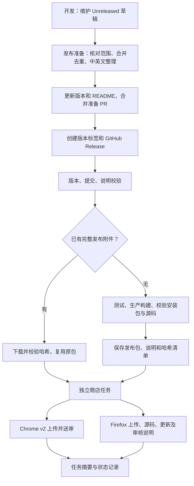

# 自动发布流程

本文对应 `.github/workflows/release.yml` 和 `scripts/release/`。发布工具固定为 `publish-browser-extension@6.1.1`，直接使用其 API，不在 CI 临时下载最新版。

`patches/publish-browser-extension@6.1.1.patch` 修复该版本的两个行为：校验轮询异常需清理计时器并拒绝任务，避免请求重叠；AMO 校验含错误时必须在创建版本或报告上传成功前失败。补丁由 pnpm 和锁文件管理，HTTP 合约测试会直接运行补丁后的真实客户端并模拟这些响应。升级工具时需复核是否可移除补丁；源码 ZIP 必须包含补丁，以便 `pnpm install --frozen-lockfile` 重建。

## 当前默认状态

合并工作流本身不会提交商店。未设置仓库变量 `STORE_PUBLISHING_ENABLED=true` 时，正式 GitHub Release 只会触发构建和保存附件，商店任务跳过。手动 `check` 可以在关闭开关时验证凭据；`upload` 和 `submit` 会明确拒绝执行商店写入。

这份实现不升级当前 1.5.1、不创建标签、不发布新 Release，也不修改既有商店页面。首次真正使用时，需要一个**包含本工作流和脚本的新版本标签**；旧 1.5.1 标签不包含这些脚本，不能用新版流程重新提交。

## 流程与职责

发布前整理仍需开发者完成。CI 校验对应版本有中英文非空列表、没有 TODO 等占位符，不能判断文字是否准确、完整或清晰。不要把 Unreleased 草稿直接作为正式更新说明。

GitHub Release 的正文会在保存发布附件时统一替换为 CHANGELOG 对应版本章节。附加说明应先整理进该章节。AMO 使用其中的中英文列表；Chrome 包提交接口不负责同步商店长期介绍或截图。

## 一次性配置

### Chrome Web Store

1. 在 Google Cloud 项目启用 Chrome Web Store API，创建服务账号。
2. 在 Chrome Web Store 开发者后台关联该服务账号，确认它有权管理 NextTab。
3. 取得发布者 ID 和该服务账号的 JSON 密钥。不要将 JSON、私钥或 token 放进仓库、构建附件或聊天。
4. 在 GitHub 创建 Environment `chrome-web-store`，设置以下值：

| 类型 | 名称                                  | 内容                            |
| ---- | ------------------------------------- | ------------------------------- |
| 变量 | `CHROME_PUBLISHER_ID`                 | 商店后台中的发布者 ID           |
| 密钥 | `CHROME_SERVICE_ACCOUNT_CLIENT_EMAIL` | JSON 密钥中的 `client_email`    |
| 密钥 | `CHROME_SERVICE_ACCOUNT_PRIVATE_KEY`  | JSON 密钥中的完整 `private_key` |

私钥需保存为实际多行 PEM，包含 BEGIN/END 和换行，不是带字面量 `\n` 的双重编码字符串。使用 v2 服务账号认证，无需个人 Google OAuth refresh token。

扩展 ID 在脚本中固定为 `nbeegkbcmmchnnncomjhhmljncmcclfd`，应在启用前与实际后台核对。默认正常送审，审核通过后由商店自动上架；不自动撤销审核，不启用跳过审核或分批放量。

### Firefox AMO

1. 从 AMO 的 API Credentials 页面生成个人 API key/secret。
2. 在 GitHub 创建 Environment `firefox-amo`，设置：

| 类型 | 名称                 | 内容                 |
| ---- | -------------------- | -------------------- |
| 密钥 | `FIREFOX_JWT_ISSUER` | API key / JWT issuer |
| 密钥 | `FIREFOX_JWT_SECRET` | API secret           |

固定扩展 ID 为 `nexttab@n0i0c0k.github.io`，渠道为 `listed`，兼容范围为桌面 Firefox 140+。安装包、源码 ZIP 与审核说明必须来自同一发布提交。

两组凭据分别放进对应 Environment；不要把两家商店密钥一起放入共享仓库 Secrets。这样 Chrome 任务无法读取 Firefox 凭据，反之亦然。安装依赖和构建步骤不注入商店凭据，只有提交步骤读取。

### GitHub

- 仓库 Actions 的 `GITHUB_TOKEN` 需允许工作流声明 `contents: write`，用于保存 Release 附件和正文；商店任务仅有 `contents: read`。
- 为两个发布 Environment 设置标签部署限制，例如只允许 `v*` 标签；可按团队需要设置 required reviewers。
- 仓库级 Actions Variable `STORE_PUBLISHING_ENABLED` 默认不设置。完成流程核对与首次 `check` 后，显式设置为字符串 `true`，才允许商店写入。
- 开关是仓库级变量，不能只放进某个 Environment，因为工作流在创建商店任务前也要判断它。
- 若配置 required reviewers，任务会先等待人工批准。这是仓库的部署规则，不是脚本临时增加的步骤。
- `release.published` 也会接收预发布事件，工作流会跳过预发布版本。普通 master 合并和普通标签推送不直接提交商店。

## 每次发布

1. 核对上次已发布版本以来本次真正包含的变化，整理 Unreleased：合并相同功能的条目，删除撤回和未发布内容，完成对应中英文说明。
2. 将整理结果移入 `## <版本> - YYYY-MM-DD`，保留空的 Unreleased 区域。历史未带日期的章节仍可解析，不改写已发布历史。
3. 执行 `pnpm update-version <版本>`，同步中英文 README，检查 CHANGELOG。提交发布准备 PR 并合并 master。
4. 从这个**已合并提交**创建 `v<版本>` 标签，创建对应 GitHub Release。可先保存为 Draft，使用手动 `build` 检查材料。
5. 正式发布 GitHub Release 后，CI 校验标签等于 package.json、当前 HEAD 等于标签提交、该提交已进入 origin/master、工作区没有被修改的已跟踪文件。
6. 没有已有发布包时，运行类型、lint、单测、发布恢复测试、Chromium E2E，构建 Chrome/Firefox 生产包并运行 `web-ext lint`。已保存完整发布包时，复用原产物并重新校验，不重新构建。
7. 若自动送审已启用，两家商店独立提交。查看 Actions 的各商店 Summary 与结果 JSON，区分已上传、待审核和已上架。
8. 审核可能超出一次 Actions 运行时间。任务不长期等待，也不启动定时轮询；稍后对同一标签运行 `check` 或查看商店后台，确认最终状态。

GitHub Release 的创建与发布应由开发者操作。若以后用另一个 Actions 工作流自动创建 Release，使用 `GITHUB_TOKEN` 产生的事件通常不会再次触发工作流，需要显式调用可复用任务或 dispatch；本实现不依赖这种二次触发。

## 手动运行与四种模式

GitHub → Actions → **Release extension** → Run workflow。工作流的运行 ref 选择目标 `v<版本>` 标签，输入 `tag` 填相同标签；`target` 可选 `all`、`chrome`、`firefox`。标签必须包含本实现且已合并 master，并已有对应 GitHub Release（可以是 Draft，正式 `submit` 必须已发布）。

| mode     | GitHub 侧行为                             | Chrome 行为                  | Firefox 行为                                                   |
| -------- | ----------------------------------------- | ---------------------------- | -------------------------------------------------------------- |
| `build`  | 构建或复用产物，保存本次 Actions artifact | 不读取凭据，不执行商店任务   | 不读取凭据，不执行商店任务                                     |
| `check`  | 同上，不写 Release 附件或正文             | 认证并只读查询发布／提交状态 | 认证并只读查询版本状态                                         |
| `upload` | 保存／复用 Release 附件及整理后的正文     | 上传草稿包，不提交审核       | 上传临时验证文件，不创建版本，不附加源码；正式送审会重新上传包 |
| `submit` | 保存／复用 Release 附件及整理后的正文     | 上传并正常送审，已存在则保留 | 创建版本并补齐源码、说明；同次发布的缺失材料可以重试修复       |

`upload`、`submit` 均要求发布开关开启。上传到商店已经是远端写入；`check` 才是商店只读试运行。不能把 Firefox 临时上传当成已创建版本，也不能把认证检查当成上传验证。

同版本已经上架或送审时，Chrome 不再上传或送审。Firefox 会核对该版本审核说明中 `Source commit: <SHA>.` 标记，只为本流程同一提交补齐缺失材料；不自动覆盖没有该标记的手动提交。对既有手动发布版本，使用 `check` 查看状态；需要更新安装包时发布更高版本。

若两家商店中一家失败，选择失败商店和 `submit` 重新运行，复用原产物；不需要重提另一家。全流程串行，不取消正在运行的上传。正在审核的其他版本、商店已有更高版本、拒绝／禁用状态或 Chrome 政策警告会阻止自动写入，应先在后台核查。

## 产物与完整性

GitHub Release 包含：

- `nexttab-<版本>-chrome.zip`
- `nexttab-<版本>-firefox.zip`
- `nexttab-<版本>-sources.zip`
- `release-notes.md`
- `firefox-metadata.json`：多语言版本说明、构建说明与提交标记，不包含凭据。
- `release-manifest.json`：对应版本、完整提交 SHA、以上五个文件的大小和 SHA-256。

构建后检查 ZIP CRC、manifest 版本、图标文件、Firefox ID 和桌面兼容性，检查源码 ZIP 的关键构建文件与标签工作区一致，并拒绝 `.env*`、依赖目录、本地设计材料与测试输出。每次送审前再次检查哈希与提交；已存在附件不自动覆盖，变更或移动同名标签会使校验失败。

Actions 同时保留 `release-bundle` artifact 90 天，在写入 Release 附件之前保存；单家结果保存在 `store-result-chrome` / `store-result-firefox`。重跑同一次工作流时更新同名 artifact，避免上传名称冲突。

## 失败与恢复

| 情况                            | 处理                                                                                                 |
| ------------------------------- | ---------------------------------------------------------------------------------------------------- |
| 缺少凭据或认证失败              | 修正对应 Environment，再运行该商店 `check`                                                           |
| 上传成功但送审失败              | 先 `check`；确认尚未送审后重新 `submit`，不自动取消已有审核                                          |
| Chrome 同版本已经待审核／已上架 | 跳过上传和送审，保留现状；不会改变已有分批放量比例                                                   |
| Firefox 创建版本后源码上传失败  | 同标签重新 `submit`，通过提交标记识别已有版本并补传源码，不新建版本                                  |
| Firefox 说明或兼容信息补写失败  | 同标签重新 `submit`，补齐并读取验证；没有同一提交标记时停止                                          |
| 某次 API 超时，结果未知         | 不自动重复写请求。先 `check`，再决定是否 `submit`                                                    |
| 商店返回拒绝、禁用、政策警告    | 到后台核查；需要改代码时发更高版本，不强行覆盖或绕过审核                                             |
| Release 附件仅上传了一部分      | 从原运行的 `release-bundle` 恢复缺失文件，完成六个附件后再重跑；不要删除原包后用新构建冒充同一批产物 |
| 产物哈希或源码文件不匹配        | 停止送审，调查是否改动标签／附件；不自动覆盖文件                                                     |

部分附件的具体恢复方法：下载原运行的 `release-bundle` artifact，解压到独立目录；对照 `release-manifest.json` 核对文件哈希，从该目录用 `gh release upload <标签> <缺失文件>` 逐个补齐，**不使用 `--clobber`**。最后同标签运行 `check`，工作流会读取全部附件重新验证。原 artifact 丢失或内容有冲突时，不自动恢复，需核查后重新准备新版本。

`published` 只在商店 API 返回已公开状态时记录；`submitted` 表示请求已接收但状态尚未同步，`pending_review` 表示待审核，`staged` 表示已审待发布。Actions 绿色不代表已经上架；商店之间也不保证同一时刻上架。

## 本地验证与后续扩展

- `pnpm test:release`：使用模拟商店响应测试重复提交、降级、审核冲突、源码／说明失败恢复；使用临时 ZIP 测试材料一致性。不会访问商店或读取真实凭据。
- `pnpm exec eslint scripts/release --ext .mjs`、`pnpm exec prettier scripts/release .github/workflows/release.yml --check`：发布代码与工作流格式检查。
- 常规类型、lint、单测、双浏览器生产构建仍按开发指南执行。发布工作流额外运行 Chromium E2E；原生 Firefox 授权交互仍需按变化人工检查。

后续可单独评估 Chrome OIDC 短期凭据、审核后暂缓发布、自动状态轮询、发版准备 PR 和 Edge 商店。当前版本没有自动更换截图、改写商店长期介绍、自动升版本或承诺双商店同步上架。

## 官方参考

- [Chrome v2 与旧 API 迁移](https://developer.chrome.com/blog/cws-api-v2)
- [Chrome 服务账号](https://developer.chrome.com/docs/webstore/service-accounts)
- [Chrome 发布状态](https://developer.chrome.com/docs/webstore/api/reference/rest/v2/publishers.items/fetchStatus)
- [AMO 版本创建和编辑接口](https://mozilla.github.io/addons-server/topics/api/addons.html#version-create)
- [AMO API 凭据](https://addons.mozilla.org/developers/addon/api/key/)
- [WXT 发布指南](https://wxt.dev/guide/essentials/publishing.html)
- [发布工具配置](https://github.com/aklinker1/publish-browser-extension/blob/main/docs/config-reference.md)
- [GitHub Release 事件](https://docs.github.com/en/actions/reference/workflows-and-actions/events-that-trigger-workflows#release)
